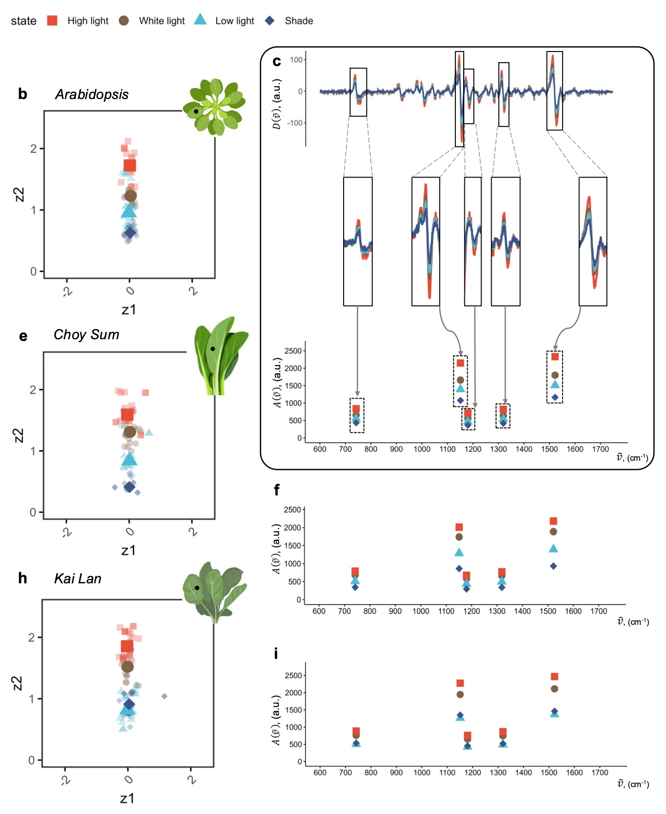

[](https://braph2software.bsky.social)
[](https://twitter.com/braph2software)
[](https://doi.org/10.1371/journal.pone.0178798)
[](https://github.com/yu-wei-c/DiSTAP/releases)
[](https://arxiv.org/abs/2507.15772)

# BRAPH 2 DiSTAP

The **BRAPH 2 DiSTAP** distribution provides a variational autoencoder (VAE)–based pipeline, DIVA, for analysing **Raman spectra in plant–stress experiments**. DIVA is a fully automated technique that uses a variational autoencoder to process native Raman spectra, including fluorescence background, to identify and quantify significant Raman peaks. This distribution supports the analyses presented in the following manuscript and enables users to apply the same workflow to their own datasets, via both command-line scripts and a ready-to-use graphical user interface:

> Patil et al., *Raman spectra for plant-stress analysis using deep-learning* (preprint).  
> [arXiv:2507.15772](https://arxiv.org/abs/2507.15772)

This distribution reuses the core analytical infrastructure of the standard BRAPH 2 distribution. For a general introduction to BRAPH 2, please refer to the main [BRAPH 2](https://github.com/braph-software/BRAPH-2/tree/develop) repository and its [tutorials](https://github.com/braph-software/BRAPH-2/tree/develop/tutorials).

<p align="center">
  
</p>

> 
> **Light-stress study (Figure 2 in Patil et al.)**  For *Arabidopsis* (b), *Choy Sum* (e) and *Kai Lan* (h), the two-dimensional latent space (z1, z2) of the DIVA model, with the cluster median of each light condition (high light, white light, low light and shade) shown as the large marker. The latent spaces show the first measurement location of each leaf (loc1, 20 spectra per condition), as in the manuscript; the model itself is trained on both locations. (c) The derivative Raman spectra decoded from the cluster medians, with the most significant peaks zoomed in and their peak areas below; (f) and (i) give the peak areas for *Choy Sum* and *Kai Lan*. All panels can be reproduced with `braph2distap/pipelines/VariationalAutoencoderRamanSpectra/example_LightStress.m`, which writes its outputs to `braph2distap/pipelines/VariationalAutoencoderRamanSpectra/study_LightStress`.

## DiSTAP studies and folder structure

Within this repository, the DIVA pipeline for Raman spectra is organised under:

- `braph2distap/pipelines/VariationalAutoencoderRamanSpectra/`

This folder contains five example scripts for the four studies of the manuscript (the bacterial stress study has one script per species), each with its study folder:

1. **Light stress study**  
   - Study folder: `study_LightStress` 
   - Example script: `example_LightStress.m`
   - Data folder: `study_LightStress/data`
   - Used to generate the panels in Figure 2 of the manuscript.

2. **Shade avoidance stress study**  
   - Study folder: `study_ShadeAvoidanceStress`  
   - Example script: `example_ShadeAvoidanceStress.m`  
   - Data folder: `study_ShadeAvoidanceStress/data`
   - Used to generate the panels in Figure 3 of the manuscript.

3. **High temperature stress study**  
   - Study folder: `study_HighTemperatureStress` 
   - Example script: `example_HighTemperatureStress.m`   
   - Data folder: `study_HighTemperatureStress/data`
   - Used to generate the panels in Figure 4 of the manuscript.

4. **Bacterial stress study**  
   - Study folder: `study_BacterialStress`  
   - Example script: `example_BacterialStress_AB.m` and `example_BacterialStress_CS.m` 
   - Data folder: `study_BacterialStress/data_AB` and `study_BacterialStress/data_CS`
   - Used to generate the panels in Figure 5 of the manuscript.

Each study folder contains:

- The original Raman spectra (in the data folder) of the corresponding plant-stress experiment.
- After running the example script:
  - the figure panels, made with the same algorithms and settings as in the manuscript;
  - the cross-validation tables and figures that justify the number of training epochs;
  - the intermediate files used by the R figures (`analysis`) and the trained model (`trained_b2_files/nne.b2`).

  For the bacterial stress study, the last two folders end in `_AB` or `_CS`.

Because the VAE starts from random weights and the cross-validation folds are drawn at random, the numbers of a rerun can differ slightly.

## What the example scripts do

Each example script:

1. loads the Raman spectra of its study, keeps 600–1750 cm⁻¹, divides them by 100 and takes the first derivative;
2. chooses the number of training epochs by 5-fold cross-validation: the spectra of one leaf location stay in one fold, and training stops where the validation loss levels off, before overfitting starts;
3. trains the DIVA model on all spectra of the study for that number of epochs;
4. makes the figures and the peak analysis.

Only leaf spectra are used: the polystyrene reference (`ps`) and petiole spectra are removed.

| Study | Spectra used for training | Spectra shown in the figures | Epochs | Plateau onset per fold | Overfitting onset per fold |
|---|---|---|---|---|---|
| Light stress | 470 | `loc1` | 16 | 15–17 | 30–44 |
| Shade avoidance | 220 | all | 21 | 20–24 | 26–36 |
| High temperature | 360 | all | 17 | 15–18 | 34–53 |
| Bacterial, *Arabidopsis* | 715 | `loc3` | 11 | 11–12 | 73–136 |
| Bacterial, *Choy Sum* | 625 | all | 15 | 14–16 | 79–116 |

## Software requirements

To run **BRAPH 2 DiSTAP**, you need:

### MATLAB

- MATLAB (R2022a or later is recommended).
- The following toolboxes:
  - **Statistics and Machine Learning Toolbox**
  - **Deep Learning Toolbox**
  - **Parallel Computing Toolbox**

### Docker (for R-based figure generation)

Some figures (e.g. colour palettes and latent-space quantile plots) are produced by R scripts that are executed inside a Docker container. For this functionality you need:

- **Docker Desktop** (or an equivalent Docker installation)  
  Installation instructions: <https://docs.docker.com/get-started/>

After installation, you should verify that `docker` is available **both** in your system terminal and within MATLAB:

In a **terminal** (macOS/Linux/Windows PowerShell):

```
docker --version
```
Then in the MATLAB Command Window:
```
[st,out] = system('docker --version');
disp(out)
```
You should see something like:
```Docker version 28.x.x, build <hash>```
and st should be 0.

If Docker works in your terminal but not in MATLAB, you may need to extend MATLAB’s PATH, for example on macOS:
```
% Example: if "which docker" in Terminal returns /usr/local/bin/docker
setenv('PATH', [getenv('PATH') ':/usr/local/bin']);
```
(adjust the directory according to the output of which docker on your system).

## Getting started: running BRAPH 2 DiSTAP

Once the repository is downloaded or cloned, you can run the DiSTAP distribution directly from MATLAB.
1. Launch the DiSTAP distribution
```
cd braph2distap
braph2distap
```
<p align="center">
  
</p>

> 
> **Landing GUI** This figure shows the landing graphical user interface (GUI) after running ``braph2distap``. The landing GUI provides four ready-to-use pipelines for processing and analysing Raman spectra. In particular, the fourth pipeline—**DiSTAP DIVA Pipeline Raman Spectra Variational Autoencoder with Multilayer Perceptron**—is the same DIVA pipeline used for all four studies in the accompanying manuscript (Patil et al.). After opening the pipeline, users can walk through the full workflow step by step, including the cross-validation step that chooses the number of training epochs.
> 

2. Run the example scripts
To reproduce the analyses and figures using the same data and algorithm from the manuscript, run any of the example scripts (each takes about 10–20 minutes, most of it the cross-validation; Docker must be running for the R figures):
```
example_LightStress           % Light-stress study
example_ShadeAvoidanceStress  % Shade-avoidance study
example_HighTemperatureStress % High-temperature study
example_BacterialStress_AB    % Bacterial-stress study (Arabidopsis)
example_BacterialStress_CS    % Bacterial-stress study (Choy Sum)
```

## Software compilation

The compiled version of this distribution is already included in this repository under the braph2distap folder. However, if you extend the pipelines (for example, by adding new studies or altering the VAE architecture) you may wish to recompile.
You can recompile DiSTAP using the BRAPH 2 Genesis mechanism. In MATLAB:
```
% Example – adapt the configuration filename to your setup
braph2genesis('braph2distap_config.m');
```
This will re-generate the braph2distap folder with the updated elements and GUIs.
Warning:
Before recompiling, remove the existing braph2distap folder and take it off the MATLAB path to avoid conflicts. The folder will be recreated after a successful compilation.

## Citing

If you use BRAPH 2 DiSTAP in your work, please cite:

> Patil et al., *Raman spectra for plant-stress analysis using deep-learning* (preprint).  
> [arXiv:2507.15772](https://arxiv.org/abs/2507.15772)

> Chang et al., *BRAPH 2: a flexible, open-source, reproducible, community-oriented, easy-to-use framework for network analyses in neurosciences* (preprint).
> [biorXiv:10.1101/2025.04.11.648455](https://doi.org/10.1101/2025.04.11.648455)

